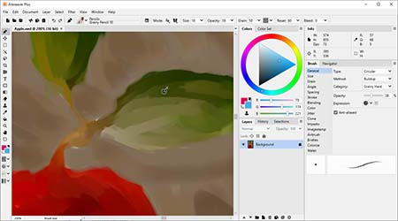
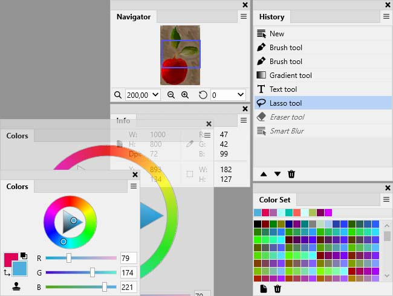

# Artweaver Plus for Expressive Painting and Editable Artwork

**Artweaver Plus 8** brings natural-media brushes, layered editing, and painting-process playback into one application.
Use it to explore an image while keeping room to change its structure, color decisions, and final delivery format.

[](https://artweaver-plus-8.github.io/Artweaver-Plus/)

## A painting you can revise

An **Artweaver Plus** document can separate the background, sketch, painted forms, and finishing details into layers.
Treat that separation as part of the composition: a change to one element should not require repainting everything beneath it.

Choose the canvas dimensions for the intended output before building a detailed study.
For a printed piece, physical size and pixels per inch determine the pixel dimensions.

This independent Python calculation gives a starting size for a 20 by 15 cm image at 300 pixels per inch:

```python
width_cm, height_cm = 20, 15
ppi = 300
width_px = round(width_cm / 2.54 * ppi)
height_px = round(height_cm / 2.54 * ppi)
print(f"{width_px} x {height_px} pixels")
```

The result is 2362 by 1772 pixels.
Enter the chosen dimensions in Artweaver's new-document dialog; the calculation does not create or configure an Artweaver document.

Use the Layers palette to select, hide, lock, and group layers.
Opacity and blend modes let you test how one painted element interacts with another.
Keep an editable working document and save a separate copy when a delivery format requires different settings.

Reference-material note: the local links below belong to a partial MyPaint snapshot, not to Artweaver's proprietary implementation.
They provide color references and interface-design examples; no cross-application preset compatibility is implied.

For a value study, [Greys16.gpl](palettes/Greys16.gpl) supplies a readable grayscale reference.
MyPaint's [layers.png](pixmaps/layers.png), [layer_duplicate.png](pixmaps/layer_duplicate.png), and [cursor_alpha_lock.png](pixmaps/cursor_alpha_lock.png) offer visual examples of layer-related interface cues.

The [Artweaver layers guide](https://documentation.artweaver.de/8/en/layers.html) describes the actual controls used by the target application.

## A brush study with one variable at a time

When moving from **artweaver plus 7**, revisit the version 8 brush controls rather than relying on an old workspace screenshot.
Version 8 brings brush settings back into a brush palette and places mirror painting within the brush tool.

A small test sheet makes brush choices easier to compare than a complex painting does.
Repeat the same marks while changing one setting:

- Draw a light stroke and a firm stroke to inspect pressure response.
- Repeat a curved line to evaluate smoothing.
- Place several overlapping marks to inspect buildup.
- Compare a short stroke with a long stroke at the same brush size.
- Save a useful result as a named brush variant.

Artweaver supports configurable brushes representing tools such as pencils, chalk, and charcoal.
Brush behavior and paper texture both affect the visible result, so keep the paper choice constant during the first comparison.



On Windows, the documentation identifies Wintab and Windows Ink as tablet interfaces.
Use **Edit > Pen Calibration** to adjust the pen's minimum pressure, maximum pressure, and pressure distribution.

The vendor's [version 8 changes](https://www.artweaver.de/en/whatsnew) explain the relocated controls.
Its [tablet guide](https://documentation.artweaver.de/8/en/pen-tablet-support.html) describes calibration separately from brush customization.

For visual comparison, the MyPaint resources distinguish drawing, erasing, and sampling through [cursor_pencil.png](pixmaps/cursor_pencil.png), [cursor_eraser.png](pixmaps/cursor_eraser.png), and [cursor_color_picker.png](pixmaps/cursor_color_picker.png).

## A limited palette with distinct values

Review **artweaver plus features** through a concrete color exercise: one light, one dark, and a small set of middle colors.
A limited selection makes it easier to notice whether the composition depends on value contrast or only on hue.
Color references complement **artweaver plus brushes**: a palette specifies colors, while a brush controls how marks are made.

The supplied palette files are readable RGB references.
Choose a group for a study, then recreate the needed colors in an Artweaver Color Set.

**Temperature studies**

- Compare [Warm_Colors.gpl](palettes/Warm_Colors.gpl) with [Cool_Colors.gpl](palettes/Cool_Colors.gpl) when testing warm subjects against cool surroundings.
- Explore earth-color relationships with [Browns_And_Yellows.gpl](palettes/Browns_And_Yellows.gpl).
- Use [Reds_And_Purples.gpl](palettes/Reds_And_Purples.gpl) as a separate reference for red-to-violet accents.

**Restricted and softer selections**

- [Classic_4.gpl](palettes/Classic_4.gpl) contains four named pigment approximations for a deliberately restricted study.
- [Muted.gpl](palettes/Muted.gpl) and [Pastels.gpl](palettes/Pastels.gpl) offer contrasting starting selections.
- [Watercolor.gpl](palettes/Watercolor.gpl) provides another swatch collection; its name does not change the selected brush's paint behavior.

**Broader comparison sets**

- [MyPaint_Default.gpl](palettes/MyPaint_Default.gpl) provides a general reference with named colors.
- [Tango_Palette.gpl](palettes/Tango_Palette.gpl) groups colors from the Tango palette.
- [GIMP_Default.gpl](palettes/GIMP_Default.gpl) provides a separate selection from the GIMP distribution.

A hand-written GIMP palette reference follows this simple text structure:

```text
GIMP Palette
Name: Evening Study
Columns: 3
38 46 64 Shadow
171 112 86 Midtone
239 214 166 Light
```

These are RGB channel values on a 0 to 255 scale.
Use them as color specifications rather than assuming that Artweaver imports this palette format.

In Artweaver, open **Window > Show Color Set** to work with saved colors.
Add chosen colors individually, or capture a Color Set from an image or layer.
Save the resulting set under a name that identifies the painting or study.

The [Color Sets documentation](https://documentation.artweaver.de/8/en/color-sets.html) explains adding colors, capturing sets, and saving them.

## A file for another editor or a finished presentation

Choose the file format according to what the recipient needs to retain.
Keep the editable master separate from a preview or exchange copy.

| Format | Role in the painting workflow | Review before handoff |
| --- | --- | --- |
| AWD | Native Artweaver working document | Reopen the saved master and inspect its layers |
| PSD | Exchange with another image editor | Check the result in the receiving application |
| PNG | Raster presentation copy | Review dimensions, transparency, and appearance |
| JPEG | Opaque raster preview | Review compression and the background |
| SVG input | Reference artwork read by version 8 Plus | Inspect how the imported artwork appears |

Artweaver supports layers and layer groups, with extended PSD support in Plus.
A format name alone does not establish that every application preserves every editing feature.

For a small color reference, save the following independent SVG example as a separate document.
Artweaver 8 Plus lists SVG reading among its supported additions.

```svg
<svg xmlns="http://www.w3.org/2000/svg" width="300" height="100">
  <rect width="100" height="100" fill="#262e40"/>
  <rect x="100" width="100" height="100" fill="#ab7056"/>
  <rect x="200" width="100" height="100" fill="#efd6a6"/>
</svg>
```

The three rectangles reproduce the shadow, midtone, and light values from the color exercise.
Opening this reference does not imply that Artweaver is a general-purpose SVG authoring tool.

Use **File > Save As** to create a separately named copy.
For numbered working revisions, **File > Iterative Save** creates successive filenames.

The [document guide](https://documentation.artweaver.de/8/en/working-with-documents.html) covers document dimensions and saving.
The [edition comparison](https://www.artweaver.de/en/compare) describes the available format and document capabilities.

## A process someone else can review

Painting event recording preserves a sequence that can be replayed later.
Use it to examine when large shapes were established, when colors changed, and when finishing marks were added.

A useful review asks:

1. Was the subject readable before the smallest details appeared?
2. Which brush changes improved the result?
3. Did later color choices strengthen or weaken the original value structure?
4. Which part of the process would benefit from a separate study?



Plus also provides protection options for saved events.
Review the [event-recording description](https://www.artweaver.de/en/features/events) when preparing a process demonstration.

Keep frequently used controls close to the canvas by arranging and docking palettes.
Artweaver Plus supports custom palettes, configurable shortcuts, and saved workspace layouts.

For comparison with another painting interface, [mypaint_widgets.xml](glade/mypaint_widgets.xml) describes MyPaint widgets used by its Glade catalog.
The [cursor_hand_open.png](pixmaps/cursor_hand_open.png) resource provides an example of a navigation cursor.

## Match the edition and workstation to the project

Artweaver Plus uses a one-time purchase with a non-expiring license.
The vendor includes updates within the same major version; review its [license terms](https://www.artweaver.de/en/buy) for the current conditions.

Artweaver Free is restricted to non-commercial and academic use.
For paid work, confirm the edition before starting the project.

The current [download page](https://www.artweaver.de/en/download) lists version 8.1.7 for Windows and macOS.
Its Windows requirements include Windows 10 64-bit version 21H2 or later, 6 GB RAM, and DirectX 11 graphics.
The macOS requirements start at macOS 13; a pen tablet is recommended for both platforms.

## Related Search Terms

Artweaver Plus 8, Artweaver Plus, artweaver plus 7, artweaver plus features, artweaver plus brushes, digital-painting, painting, drawing, brushes, graphics-tablet, raster-graphics, image-editing, layers, color-palette, art
